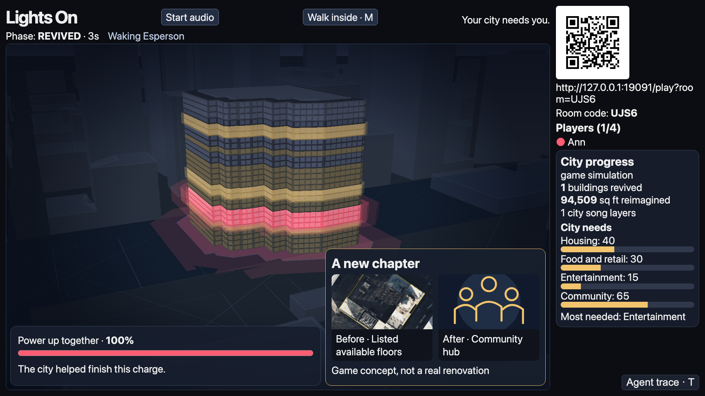
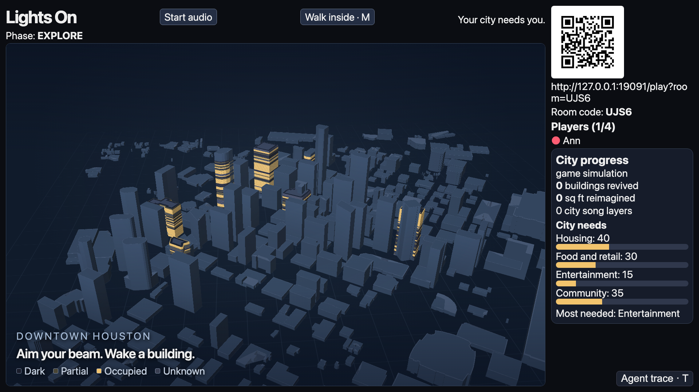
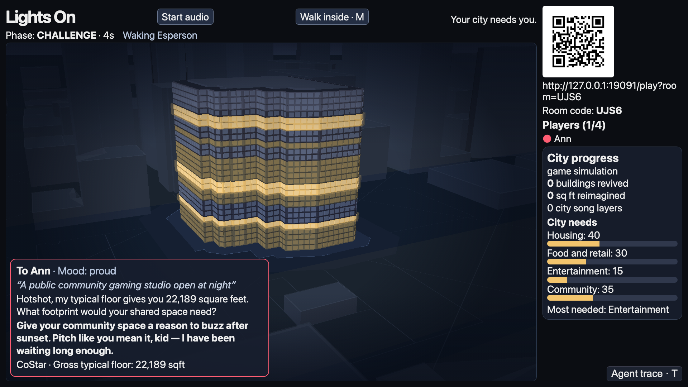
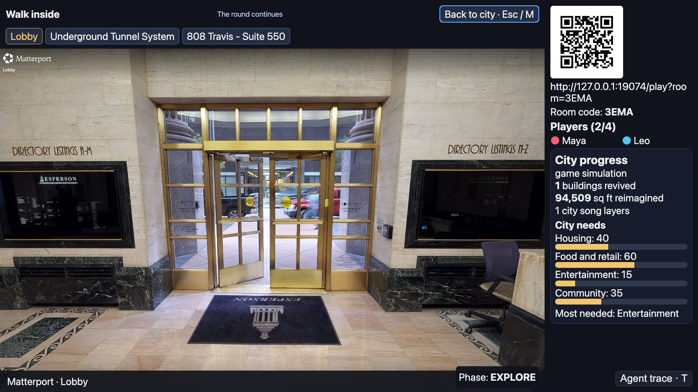
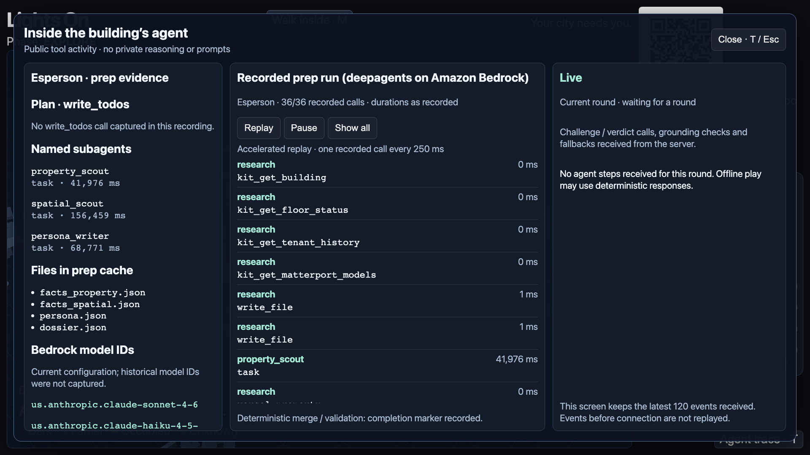
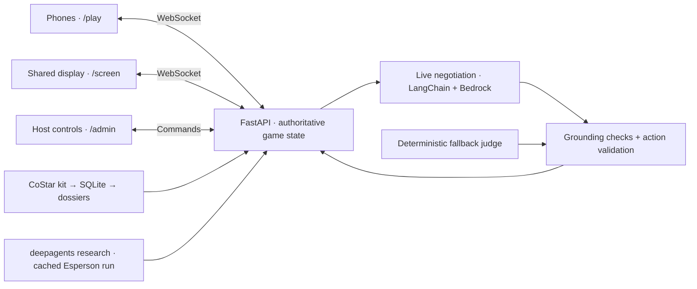

<div align="center">

# Lights On

### Shark Tank, but the investor is a dark skyscraper.

**Real buildings. Bold pitches. One skyline to bring back to life.**

A multiplayer party game built at **HackPrinceton Fall 2026**.

[The game](#the-game) · [Screenshots](#see-it-in-action) · [Run it](#run-it-locally) · [Under the hood](#under-the-hood) · [Demo guide](docs/submission/demo-script.md)

</div>



## The game

What if a building could hear your idea for its next chapter—and argue back?

Lights On turns downtown Houston into a shared game board. Join from your phone, wake an office tower, and pitch a new use for its dark floors. The building responds as an AI character with its own personality and a dossier of real evidence. It challenges your idea, makes a counteroffer, and gives you one chance to revise.

Win the pitch, then get the whole room to help: everyone taps to charge the building, its floors light up in the winner's colour, and a new layer joins the city song.

**You compete for the pitch. Everyone shares the skyline.**

| Beat | What happens |
| --- | --- |
| **Join & aim** | Scan the projector's QR code. Use your phone browser to select a building—no app install. |
| **Wake** | Dive from the skyline to the tower. In the Esperson demo, aerial imagery and a real interior tour introduce the setting. |
| **Pitch** | Propose a new use by typing or supported browser dictation. Demo mode gives you 20 seconds. |
| **Negotiate** | Answer a challenge grounded in the building's dossier. Revise your pitch after its counteroffer. |
| **Verdict** | The building scores the proposals across four criteria and explains its choice. |
| **Light it up** | Tap together to charge the winning floors. Watch the lights, concept card, city needs and soundtrack change. |

Built for a shared display and a room of players, with phone controls, subtitles and typed input throughout. Future uses could include classroom activities, city engagement sessions and leasing events.

> The building is a game character. Its verdict is not a feasibility assessment, and a light-up is a game outcome—not a real renovation.

## See it in action

| A city you can play | A building that pushes back |
| :---: | :---: |
|  |  |
| **Pick a tower. Pitch its next chapter.** | **Real constraints become part of the conversation.** |

| Walk inside | Follow the research |
| :---: | :---: |
|  |  |
| **Explore a real interior through Matterport.** | **Replay the deepagents run behind Esperson's persona.** |

Screenshots show saved demo sessions; their QR codes and room links are not a hosted demo. Start a fresh session using the instructions below.

## What makes it different

- **The city supplies the constraints.** CoStar floor and property records anchor the dialogue. Vexcel adds aerial and spatial evidence; Matterport lets players look inside.
- **Negotiation is the game.** Players respond to counteroffers instead of submitting a prompt and waiting for a score.
- **The payoff belongs to everyone.** The winning pitch becomes a shared charging moment, a lit tower and another layer in the city song.
- **AI stays off the control path.** Pointer, hover and charge feedback do not wait for model calls. The server validates proposed actions before changing state.
- **A round has a fallback.** A deterministic judge can use the dossier when live generation times out, exceeds its budget or fails validation. Typing, taps and subtitles remain available.

## Under the hood



### Two stages of AI

**Before play: research the building.** A LangChain `deepagents` workflow on Amazon Bedrock delegates to `property_scout`, `spatial_scout` and `persona_writer`. They inspect scoped evidence and write research artifacts; the server merges and validates the results. Esperson has a recorded, cached research run. Seven Houston buildings have data-grounded personas, but that does not mean all seven received a full deepagents run.

**During play: negotiate with players.** A LangChain agent uses dossier lookup tools to answer pitches. Claude Haiku 4.5 handles challenges and claim checks; Claude Sonnet 4.6 handles verdicts. Cited facts, numbers and units pass grounding checks, and proposed state changes pass [`actions.py`](server/app/actions.py). These checks reduce unsupported output; they are not a guarantee of perfect semantic accuracy.

A persistent spend ledger limits Bedrock usage. The default cap is **$3.00**, with a code-enforced maximum of **$4.50**. Budget refusal follows the same fallback path as other unavailable live responses.

### Real, cached or simulated?

| Layer | What the game uses |
| --- | --- |
| **Property and floor records** | Real CoStar hackathon data, filtered to Office (`propertyType 5`) and streamed into SQLite. |
| **Aerial and spatial evidence** | Real Vexcel imagery and detections, fetched ahead of play and cached. Detection facts retain their estimate qualifiers. |
| **Interior tours** | Real Matterport tours loaded in embedded players using model IDs from the kit. These need network access. |
| **Research trace** | A replay of Esperson's recorded deepagents prep run, labelled as recorded. The prompt requests `write_todos`; that call was not captured in the saved run. |
| **Challenges and verdicts** | Live Bedrock generation in live mode, or deterministic dossier-based dialogue in fallback mode. |
| **City needs and revival totals** | Game simulation, not measured changes in Houston. |
| **Concept cards** | Game art labelled “Game concept, not a real renovation.” |

**Floor status is evidence, not a guess.** Floors are `dark`, `partial`, `occupied` or `unknown`. A known floor can be dark when at least 90% of its area is listed as available and recorded occupied area is zero, with current-tenancy checks taking precedence. Missing evidence stays unknown. This does not establish whether people are physically present. See the [floor-status implementation](server/app/data/floor_status.py) and [data rules](docs/PRD.md).

Broker and owner contacts are excluded from the game UI and model context. Keys belong in the root `.env`; raw kit data, local media and secrets are not committed.

### Stack

| Area | Tools |
| --- | --- |
| Shared display & phones | React, TypeScript, Vite, MapLibre GL, Zustand |
| Audio & input | Tone.js, Web Speech API, touch controls |
| Server & contracts | Python 3.11, FastAPI, WebSockets, Pydantic v2 |
| AI | Amazon Bedrock, Claude Haiku 4.5, Claude Sonnet 4.6, LangChain, deepagents |
| Evidence | CoStar kit, SQLite, Vexcel API 2.0, Matterport |
| Verification | pytest, Vitest, Playwright, grounding evals |

## Run it locally

You need **Python 3.11**, **uv**, **Node.js 20+** and **pnpm 9**. Install **cloudflared** if you want the demo launcher to create an HTTPS phone link.

### 1. Install

From the repository root:

```sh
cp .env.example .env
pnpm install
uv sync --project server
```

Set your own `HOST_PIN` in `.env`. Keep credentials there; do not commit the file. If `.env` already exists, preserve it instead of copying over it.

### 2. Rehearse with fixtures

No CoStar kit or model credentials are required for this path. It uses committed dossiers and a deterministic judge, with no paid model calls.

```sh
./scripts/demo.sh --fixtures --no-tunnel
```

Open **http://localhost:5173/screen**. For a shareable HTTPS phone link, install cloudflared and run without `--no-tunnel`:

```sh
./scripts/demo.sh --fixtures
```

The launcher prints the screen, player and host URLs. External imagery, tours and recorded research artifacts may be unavailable on a fresh clone; the fixture game does not require them.

### 3. Play with the real kit and live AI

Place the supplied CoStar kit in `data/costar/`, including its `data/` and `schemas/` directories. Configure AWS credentials and `AWS_REGION` in `.env`, with access to the Bedrock models used by the project.

```sh
# Stream the supplied kit into its local index once.
uv run --project server python scripts/build_kit_index.py

# Start kit mode + live Bedrock + demo timers + an HTTPS tunnel.
./scripts/demo.sh
```

**Live mode spends Bedrock budget.** The launcher enables `DATA_MODE=kit`, `AGENT_MODE=live` and `DEMO_MODE=1`. Use `--dry-run` to inspect its startup plan, or `--no-tunnel` for a local session. Press **Ctrl-C** to stop the processes it starts.

For normal development, `./dev.sh` runs the API on port **8000** and Vite on **5173**, using your environment settings.

### Host a round

| Surface | Purpose |
| --- | --- |
| `/screen` | Shared display. Click **Start audio** once to enable sound. |
| `/play` | Phone controller. Join using the QR code from the current screen session. |
| `/admin` | Enter `HOST_PIN` to access phase, reset and data-mode controls. |

On the shared display, **M** toggles an available interior tour, **T** toggles the research trace, and **H** opens host controls. Use an HTTPS link for phone sensor permissions; touch selection and tap-to-charge provide the fallback controls. The demo presentation targets a **1920 × 1080** shared display and Esperson.

For a guided run, use the [demo script](docs/submission/demo-script.md) or [human playtest checklist](docs/TEST-TONIGHT.md).

<details>
<summary><strong>Configuration reference</strong></summary>

Server settings are read from the root `.env`; exported environment variables take precedence.

| Variable | Default / purpose |
| --- | --- |
| `DATA_MODE` | `kit`; use `fixtures` for committed dossiers without the kit index. |
| `AGENT_MODE` | `fake`; use `live` for Bedrock negotiation. |
| `DEMO_MODE` | Off unless enabled. `1` selects shorter demo timers: 20-second pitch, 15-second negotiation. |
| `DEMO_BUILDING_IDS` | `233953,233899` (Esperson and Wells Fargo Plaza); eligibility still requires a persona and dark floors. Set `233953` for the Esperson-only presentation. |
| `COSTAR_DATA_DIR` | `data/costar`; the kit index location. For a custom directory, also pass `--kit-dir` to the index builder. |
| `HOST_PIN` | Host control PIN; replace the example value. |
| `PUBLIC_BASE_URL` | Public web URL used in QR links; the tunnel demo launcher sets this automatically. |
| `AWS_REGION` | AWS region for Bedrock; the example uses `us-east-1`. |
| `BEDROCK_SPEND_CAP_USD` | `3.00`; accepted values range from `0` to the enforced ceiling of `4.50`. |
| `PREP_TRACE_DIR` | `server/cache/prep`; cached research artifacts, including `<id>/agent_steps.json`. |
| `PHASE_DURATIONS_SCALE` | `1.0`; scales phase timers, primarily for tests. |

Restart the server after changing startup settings. The data-mode switch is also available in `/admin`.

</details>

<details>
<summary><strong>Restoring aerial media and recorded research</strong></summary>

A fresh clone does not contain the private kit, Vexcel images or cached research run. Aerial images are served from `apps/web/public/media/<property id>/`, including `ortho.jpg` and `oblique-*.jpg`.

Copy these artifacts from your prepared checkout, or fetch images with your Vexcel credentials:

```sh
# Makes external Vexcel calls; requires VEXCEL_API_KEY.
# Also updates server/fixtures/vexcel/233953.json.
uv run --project server python scripts/fetch_vexcel.py 233953
```

The recorded Esperson research lives in `server/cache/prep/233953/`. For another checkout, set `PREP_TRACE_DIR` to the directory containing the prepared building folders. Without the images, the game uses its media fallback; without the recorded trace, it cannot replay that research run.

</details>

## Development & verification

```sh
# Python server suite
(cd server && uv run pytest)

# Web unit tests and messaging typecheck
pnpm -r test

# Offline agent evals, without paid model calls
uv run --project server python evals/run.py --quick

# Typecheck and production web build
pnpm --filter @lights-on/web build

# Browser tests; starts its own API and web processes
pnpm --filter @lights-on/web e2e
```

The [visible live rehearsal report](apps/web/e2e/visible-demo-run-report.md) records a complete Esperson round with two live challenges and a live verdict, with no fallback in that replacement run. It also documents the timing and presentation issues found. Later speech and visual changes mean those measurements should not be treated as a benchmark of the latest build.

### Project map

```text
apps/web/           Shared display, phone controller and host UI
server/app/         Game state, commands, action validation and adapters
server/app/agent/   Live negotiation, research, grounding and fallback judge
server/fixtures/    Committed dossiers and test/fallback artifacts
scripts/            Kit indexing, preparation, type generation and demo launcher
evals/              Agent evaluation cases and recorded results
docs/               Product spec, reviews, demo guides and submission materials
messaging/          Future messaging integration stub
```

Pydantic models in [`server/app/models.py`](server/app/models.py) are the contract source of truth. After an approved model change, regenerate client types with `uv run --project server python scripts/gen_types.py`. Contribution and data-handling rules are in [AGENTS.md](AGENTS.md).

## Current scope & next steps

The hackathon presentation centres on Esperson. Seven Houston towers have grounded personas, while full recorded deepagents research is available for Esperson. Other buildings have less demo coverage.

Browser speech synthesis provides the demo voice, and browser dictation depends on device support and permissions. The latest phone dictation and verdict speech changes still need a fresh real-device check. Typing and subtitles are the dependable demo path. ElevenLabs and LangSmith integrations are optional; they are not required to play. The Photon/iMessage controller is **not shipped**.

Next: research more buildings, expand to other cities, add a messaging controller, and explore facilitated sessions where people can discuss new uses for real office space.

## Explore more

- [Product specification](docs/PRD.md) — gameplay, contracts, data rules and acceptance checks.
- [Demo scope](docs/demo-scope.md) — the presentation path and its boundaries.
- [Devpost story](docs/submission/devpost.md) — submission copy and gallery captions.
- [Video script](docs/submission/youtube-script.md) — walkthrough and recording cues.
- [CoStar data guide](docs/costar/index.md) — source models and field interpretation.
