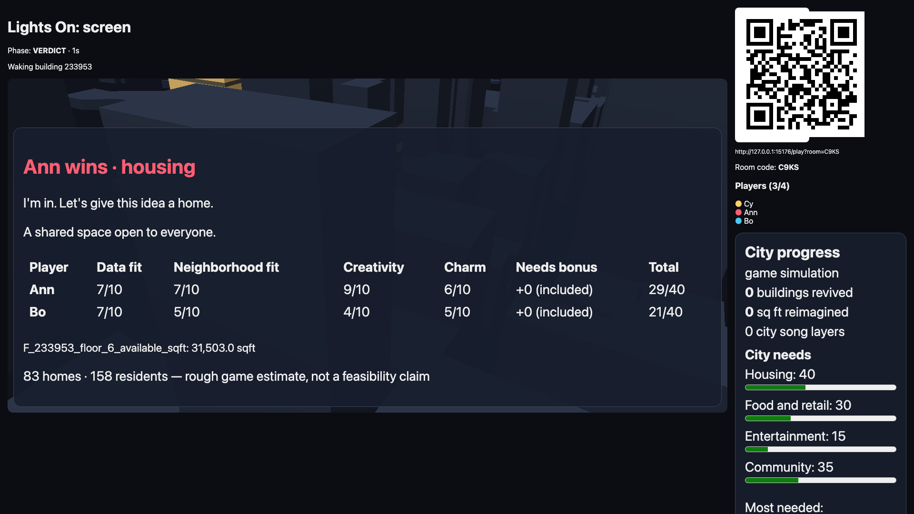
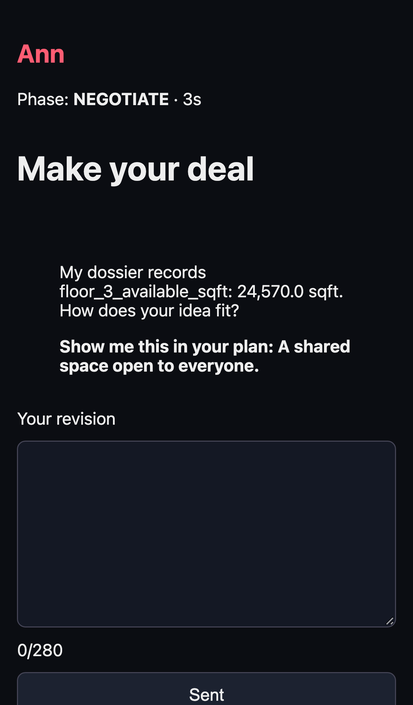

Phase 3 QA — headless gameplay exit gate: **PASS in kit and fixtures**. One separate projector layout finding remains open.

Tested product revision `03e32e4` (`phase3: playable round UI and per-floor light-up (#7)`) on 2026-11-13, on branch `qa/phase3-sweep`. Product code and contracts were not changed. This report distinguishes the gameplay gate from a separate projector layout finding.

The unmocked runner is [qa-phase3-sweep.mjs](qa-phase3-sweep.mjs). It starts the real FastAPI server and Vite app, uses the actual local CoStar SQLite index, committed dossiers/geometry, and the real deterministic fake-agent implementation. It does not intercept HTTP or WebSocket traffic. Each mode gets a fresh temporary `STATE_DIR`, one 1920×1080 desktop context for `/screen` and `/admin`, and three isolated touch contexts (iPhone 13, Pixel 7, iPhone 13); Ann and Bo actively pitch, revise, and charge, while Cy stays connected. No orientation or motion events are injected.

The initial worktree lacked ignored data. An ignored `data` symlink to `/Users/momossss/Documents/GitHub/LightsOn/data` supplied the existing kit; no kit data was copied or committed. Python was explicitly synchronized to 3.11.15. Initial failures from the missing index are environment setup failures, superseded by the results below.

| Validation | Result |
| --- | --- |
| `pnpm install`; `cd server && uv sync --python 3.11` | PASS |
| `cd server && uv run pytest` | `119 passed, 1 warning in 32.97s`; real kit present, no skips |
| `pnpm -r test` | 32 web tests passed across six files; messaging TypeScript passed |
| Existing Playwright tests after readiness guard | `10 passed (1.1m)` |
| All Playwright tests including new layout regression | `11 passed (1.2m)` means **10 normal passes and 1 explicitly expected failure**, not eleven clean product checks |
| `pnpm --filter @lights-on/web build` | PASS; existing bundle-size warning |
| `node apps/web/e2e/qa-phase3-sweep.mjs`, kit | **17/17 checks passed**, including five consecutive tap-completed rounds |
| Same unmocked runner, fixtures | **17/17 checks passed**, including five consecutive tap-completed rounds |

`PHASE_DURATIONS_SCALE=0.1` is used throughout: INTRO 0.8 s, PITCH 4.5 s, CHALLENGE 1 s, NEGOTIATE 3 s, VERDICT 1 s, POWER_UP 1 s, REVIVED 0.8 s. Phase polling uses 10 ms intervals for the brief POWER_UP window. Charging uses real touchscreen taps at the rendered button center, with more than 600 ms between each player's accepted contributions; no forced clicks, synthetic DOM events, host skips, room resets, or restarts complete the five gate rounds.

| Requested check | Kit | Fixtures | Evidence / assertions |
| --- | --- | --- | --- |
| Three phones join from displayed QR URL | PASS | PASS | Three independent identities appear on the host screen; process mode matches room mode |
| Touch aiming and hover | PASS | PASS | Actual rendered Esperson geometry selected through the phone trackpad; hover card appears |
| Five consecutive complete typed rounds | PASS | PASS | Natural timers, real server events, two original pitches and two revisions each round |
| Intro text and challenge with counteroffer | PASS | PASS | Intro subtitle visible; two actual challenge records and their dossier evidence displayed |
| Validated verdict and server scores | PASS | PASS | Winner alternates Ann/Bo; every total equals the four server criteria; unit suite checks clamping, bonus and tie-break rules |
| Shared tap charge and light-up | PASS | PASS | Charge visibly reaches 50%, then 100%; each gate revival has `auto_completed=false` |
| Floor colors match winner | PASS | PASS | Actual map expression evaluated with MapLibre's evaluator for every revived geometry feature |
| City progress and needs update | PASS | PASS | Exact dossier floor area added; song layers increment once; housing meter follows deterministic capped rule |
| Duplicate/rapid taps cannot exceed 100% or revive twice | PASS | PASS | Rate-limited burst, accepted nonce replay burst, and post-revival burst; one commit and one revival event |
| Nobody taps: timer auto-completes | PASS | PASS | POWER_UP starts at zero; timer reaches 100% with `auto_completed=true` and helper text |
| No pitches: return to EXPLORE | PASS | PASS | Actual `no_pitches` error followed by EXPLORE |
| Exhausted building rejected | PASS | PASS | All Esperson dark targets consumed; raw wake rejected with `no_dark_floors`, phase unchanged |
| Phone and screen reload mid-round | PASS | PASS | Negotiation submissions, counteroffers, identity and round restored; revision remains disabled as sent |
| Reload after revivals preserves per-floor colors | PASS | PASS | Alternating winners' individual floor colors restored from server snapshot, checked against map expression |
| SIGKILL/restart mid-round | PASS | PASS | Same `STATE_DIR`; pitches, players, city and floor states restored; clients reconnect |
| Host skip/reset round/reset room/mode switch | PASS | PASS | Actual admin controls; provider API changes mode; room reset clears players and progression |
| ScoreCard/ChallengeCards factual grounding | PASS | PASS | Every emitted fact ID resolves to a non-null fact in that building's HTTP dossier and its `say_as` appears in rendered evidence; challenge factual lines use that same text |
| Simulation/estimate labels | PASS | PASS | City meter includes “game simulation”; actual housing verdict displays “rough game estimate, not a feasibility claim” |
| Prohibited terminology and contact privacy | PASS | PASS | API dossiers, all captured socket events and rendered pages scanned; 1,428 kit contact names compared locally without persisting names |
| Console/errors/network outside deliberate outage | PASS | PASS | Every page monitored for console errors, uncaught exceptions, failed requests and HTTP errors; intentional outage and navigation cancellations recorded separately |
| Light-up starts within 300 ms | PASS | PASS | Browser-monotonic time from `building_revived` reception to first floor-color paint update, followed by final geometry color checks |

All ten gate revivals began their map color update within 300 ms; the table records each measured delay. The meter counts unique buildings rather than rounds. Four rounds exhaust Esperson's eight verified dark target floors; round five starts Wells Fargo Plaza. These are real dossier floor groups, not invented floors. Alternating winners deliberately exercises multiple ownership colors on a single building.

| Round | Building | Floors | Winner color | Cumulative sq ft | Unique buildings | Housing meter | Kit light start | Fixtures light start |
| --- | --- | --- | --- | --- | --- | --- | --- | --- |
| 1 | Esperson (233953) | 6, 7, 8 | Ann `#ff5d73` | 94,509 | 1 | 70 | 1.0 ms | 1.2 ms |
| 2 | Esperson (233953) | 17, 18 | Bo `#4cc9f0` | 127,569 | 1 | 100 | 0.8 ms | 0.9 ms |
| 3 | Esperson (233953) | 20, 21 | Ann `#ff5d73` | 145,694 | 1 | 100 | 0.6 ms | 0.7 ms |
| 4 | Esperson (233953) | 24 | Bo `#4cc9f0` | 150,365 | 1 | 100 | 0.6 ms | 0.8 ms |
| 5 | Wells Fargo Plaza (233899) | 3 | Ann `#ff5d73` | 174,935 | 2 | 100 | 0.4 ms | 0.6 ms |

Product finding — medium: real QR pushes the city-needs summary below the 1080p projector viewport.

- Where: `/screen`, real QR and the sidebar CityMeter/NeedsBars. Relevant files are `ScreenApp.tsx` and `overlays/RoundOverlays.tsx` (unchanged).
- Steps: start the actual app; open `/screen` at 1920×1080 with the generated QR; inspect the bottom of the sidebar. No player or model interaction is needed.
- Expected: the complete city meter and most-needed summary fit the projector, matching the existing round test's no-document-scroll assertion.
- Actual: even with zero players, document height is **1,110 px** for a 1,080 px viewport; the actual QR SVG is **264×264 px** and the meter bottom is **1,094.4375 px**. With three players, screenshots show more of the needs summary below the fold. The UI round tests use a 40 px mocked QR and miss this integration issue.
- Screenshot: [real QR overflow](screenshots/qa-phase3/projector-overflow.png); also visible in the real [verdict screen](screenshots/qa-phase3/verdict.png).
- Regression: [qa-phase3-layout.spec.ts](qa-phase3-layout.spec.ts) uses the real room API/QR and is explicitly marked expected failure until a separate product fix. The final `11 passed` Playwright summary includes this expected failure.

Test infrastructure finding — fixed in QA scope: the existing Phase 3 reload assertions could call MapLibre `getPaintProperty` before the `floors` layer existed. A clean baseline run produced `9 passed, 1 failed` with `TypeError: Cannot read properties of undefined (reading 'getPaintProperty')`; an earlier run failed the equivalent assertion in the fixture round. Both reload polls in `phase3.spec.ts` now check `getLayer("floors")` first. The original ten tests then passed. This changes test readiness only; it does not change map state or product behavior.

Three important screenshots are committed under `screenshots/qa-phase3/` for PR review. The full evidence stays in the ignored [artifacts/qa-phase3/](artifacts/qa-phase3/) directory, including `results.json`, screen captures for INTRO/PITCH/CHALLENGE/VERDICT/POWER_UP/REVIVED, all three phones in the longer phases, and reload/restart/charge edge cases. The final run captured 94 screenshots. Navigation-cancelled MapLibre worker downloads (`net::ERR_ABORTED`) are retained in the raw diagnostics and excluded from application failures. The JSON contains actual events, scores, floor groups, timings, checks and outage diagnostics; it contains neither keys nor kit contact records.

Limits: this proves Chromium headless touch paths, not native mobile Safari, physical sensors, vibration, venue Wi-Fi, or human comprehension. Light-start measurements cover the client map color update, not physical projector latency. Phase 4 live agents/media/voice were not exercised. Non-blocking Python deprecation and Vite bundle-size warnings remain. The projector layout finding needs a separate product change.
