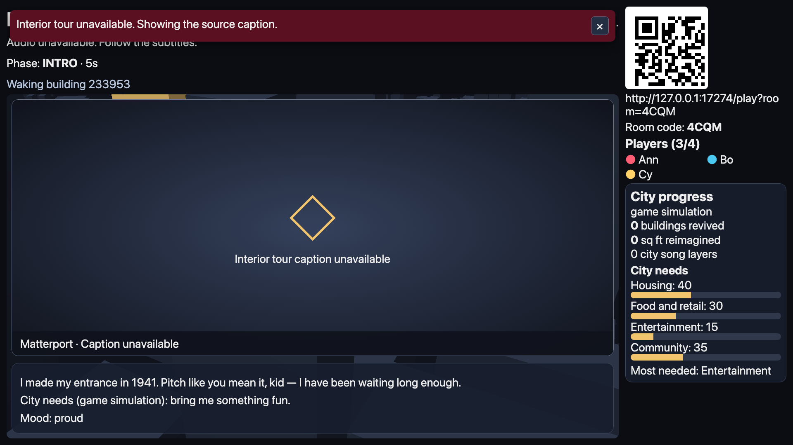
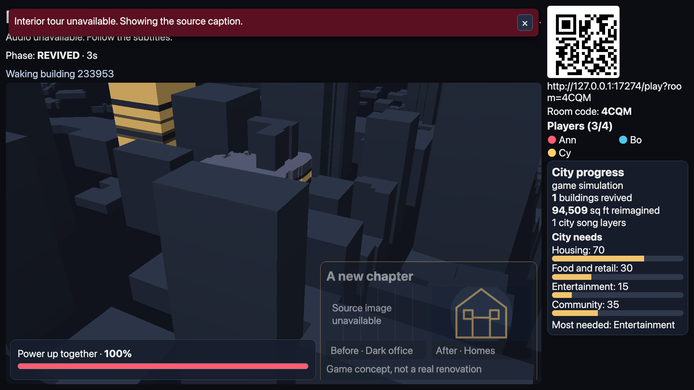
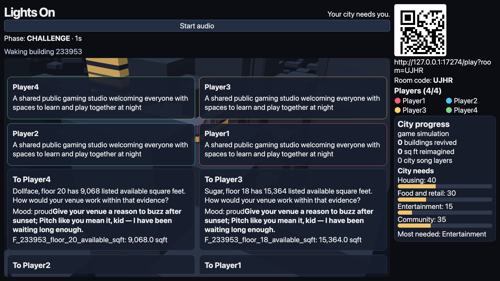

# Phase 6 QA sweep

**Result: acceptance checks fail; no product code changed.** Tested main `688f908c952d96515c834326b7d42ce76ada7f6f` with the real CoStar kit and committed fixtures. Branch: `qa/phase6-sweep`.

## Setup and method

Mounted the canonical `data` and `.env` symlinks before installation and testing. Ran `pnpm install` and `cd server && uv sync`. API port **20201**, web port **17274**; Chromium headless with SwiftShader. Each mode uses an isolated temporary state directory, one 1920×1080 desktop context for `/screen` and `/admin`, and three independent touch contexts (iPhone 13, Pixel 7, iPhone 13). Two players submit and revise typed proposals, with a third spectator; a fourth joins for layout checks. Separate regressions exercise four simultaneous pitches and revisions with four phone contexts.

The standalone [runner](qa-phase6-sweep.mjs) uses real HTTP, sockets, floor geometry, dossiers, and the deterministic fake agent. `AGENT_MODE=fake`, `BEDROCK_SPEND_CAP_USD=0`; prep model construction also has a fail-fast sentinel. Speech synthesis/recognition are unavailable and microphone permission is denied in these contexts. ElevenLabs is disabled for the sweep. No live prep, model, transcription, or voice-service requests are required; Matterport's public iframe is exercised.

Deliberation phases run at `PHASE_DURATIONS_SCALE=0.1`; INTRO retains its production **8 seconds**, and REVIVED gets **4 seconds**, so the fixed-duration dive, media beats, floor animation and ConceptCard are observable. The existing suite also runs the ordinary fully scaled configuration. Browser instrumentation observes the exposed map's actual paint expressions, flash DOM mutations, spark canvas draws, and exported `CityMusic` methods; it does not replace the visual or musical implementation. Motif validation checks scheduling, not perceived audio quality.

## Acceptance matrix

| Area | Kit | Fixtures | Evidence |
|---|---|---|---|
| Five consecutive typed rounds, natural timers, no host skips | PASS | PASS | Four Esperson rounds and one Wells Fargo Plaza round; all five charge to 100% with taps |
| Trackpad hover, tap selection, tap-to-charge | PASS | PASS | Real rendered geometry and grounded hover facts; no sensor events injected |
| INTRO dive and subtitles | PASS | PASS | Approach appears; subtitles remain visible with speech unsupported |
| INTRO timer independent of unavailable speech/media | PASS | PASS | Observed INTRO→PITCH intervals: kit 7,959–8,003 ms; fixtures 7,950–7,977 ms |
| Vexcel aerial estimate/date positive display | UNAVAILABLE | UNAVAILABLE | No local `public/media` directory in this worktree or the canonical checkout; configured missing-image skip works |
| Matterport embed/caption fallback | PASS, limited | PASS, limited | Embed/caption component appears; explicit caption fallback works; source caption is null, so no interior image/caption is available |
| Flash begins within 300 ms | PASS | PASS | Kit **2.3, 1.4, 1.3, 1.5, 1.9 ms**; fixtures **2.3, 1.1, 1.2, 1.1, 1.5 ms** from receipt of `building_revived` to flash DOM observation |
| 200 ms flash, bottom-to-top 60 ms stagger, 600 ms fade, sparks | PASS | PASS | CSS duration and frame-by-frame map expressions; adjacent floors differ by 0.1 fade progress; measured fade slope within 550–650 ms |
| Signature motif after flash | PASS | PASS | Scheduled approximately 199–200 ms after the revival handler; same first-floor timestamp as the visual sequence |
| Softer zero-tap auto-complete | PASS | PASS | `auto_completed=true`, dimmer flash, smaller/lower-opacity spark particles; city-help message and ConceptCard |
| ConceptCard required disclosure | PASS | PASS | “Game concept, not a real renovation” after floor sequence |
| City-song categories, repeat lift and speaking duck | PASS | PASS | Five housing revivals yield offsets 0/3/6/9/12 dB; active level −24/−21/−18/−15/−12 dB; speaking subtracts 8 dB; separate browser check covers all eight category mappings |
| Mic denied / speech unsupported, typed recovery | PASS | PASS | Full sweep completes; existing six voice-path cases also pass |
| Web Audio API unavailable | **FAIL** | **FAIL** | Blank screen during module initialization; finding F1 |
| 0–4-player lobby layout, 3-player round layout, projector body ≥28 px | PASS | PASS | No measured projector clipping or text below 28 px in sweep snapshots; controller document widths fit their phone viewports |
| Four-player CHALLENGE layout | **FAIL** | **FAIL** | Lower counteroffers/evidence require scrolling; finding F2 |
| Every received error event shows a toast | **FAIL** | **FAIL** | Unmatched nonce errors are discarded; finding F3 |
| Zero console errors across five rounds | **FAIL** | **FAIL** | Optional unprepared persona request returns 404; fixtures also emitted a third-party Matterport fetch error; finding F4 |
| Phone/screen reload during negotiation | PASS | PASS | Identity, submitted revision, round and counteroffers restored |
| Backend SIGKILL/restart mid-round | PASS | PASS | Same state directory restores pitches, city, colors and players; sockets reconnect |
| Host skip, round reset, room reset, mode switch | PASS | PASS | Host controls work; mode switch changes dossier provider; room reset clears city/players |
| Grounding, privacy and terminology | PASS | PASS | Cited fact IDs resolve to non-null dossier facts; evidence displays dossier text; contact-name scan covers streamed kit records; API/event/rendered text passes privacy checks |

The aerial row is a positive-path coverage limit, **not an invented-image substitute**. The coordinator's Phase 6 decisions explicitly permit skipping missing local Vexcel assets and procedural music instead of audio loop files. Known-date formatting has existing unit/evidence coverage, but an actual Vexcel aerial with a known date was not displayed in this checkout. The null Matterport caption correctly remains unavailable.

## Findings

### F1 — P0: missing Web Audio crashes the app before fallback UI

- **Where:** `/screen`, `apps/web/src/screen/music.ts` static Tone import/module initialization.
- **Steps:** Before navigation, make `AudioContext` and `webkitAudioContext` unavailable, then load `/screen`.
- **Expected:** Screen, QR, subtitles and typed-round flow remain available; starting audio shows an unavailable notice.
- **Actual:** Uncaught `nativeAudioContextConstructor2 is not a constructor`; QR and all app UI are absent, so a round cannot be hosted on that screen. Reproduced in both standalone data modes and a focused browser regression.
- **Screenshot:** [blank screen](screenshots/qa-phase6/audio-context-unavailable.png).

### F2 — P1: four-player counteroffers overflow the projector's visible area

- **Where:** `RoundOverlays` / `Bubbles` / `ChallengeCards` on `/screen`, CHALLENGE.
- **Steps:** Join four phones; each submits a normal 96-character proposal; let CHALLENGE start at 1920×1080.
- **Expected:** All four players' counteroffers and evidence are readable on the projector at ≥28 px without manual scrolling.
- **Actual:** Pitch bubbles plus the two-row challenge grid exceed the overlay's scroll viewport; the lower counteroffer text/evidence extends to roughly y=1,267–1,302, below the 1,080 px screen. Body text is 28 px, but the third/fourth counteroffers are hidden until scrolled. Both modes still complete the round, and VERDICT/REVIVED layout checks pass.
- **Screenshot:** [four-player challenge](screenshots/qa-phase6/four-player-challenge.png).

### F3 — P2: error events with unmatched nonces have no toast

- **Where:** `apps/web/src/lib/store.ts`, error reduction; `/screen` and phone sockets.
- **Steps:** On an open screen socket, send an invalid wake with a nonce outside `RoomSocket.send`'s pending map; alternatively inject duplicate/rapid/late charge commands in the real-server sweep.
- **Expected:** Every received `error` event is visible as a toast.
- **Actual:** Server replies with `not_joined`, `no_dark_floors`, `rate_limited` or `wrong_phase`, but the nonce causes the shared reducer to ignore it, and no pending promise displays it. Ordinary UI commands that catch their matched rejection are a different path and are not claimed broken here.
- **Evidence:** Focused “every error event” regression; standalone toast observations record `shown=false` for injected rate-limit and late-phase errors. Raw details are in the ignored `artifacts/qa-phase6/results.json`.

### F4 — P2: expected missing persona pollutes the screen console

- **Where:** `useScreenAudio.loadPersona`, `/api/buildings/233899/persona`.
- **Steps:** Enable screen audio; join at least two phones; wake the unprepared Wells Fargo Plaza building.
- **Expected:** Optional persona fallback preserves subtitles/default voice without a console error.
- **Actual:** GET returns 404, which Chromium logs as “Failed to load resource”; the fetch rejection is swallowed, but the console is already dirty. Observed in the fifth consecutive round in both modes. A separate external Matterport iframe fetch also logged an Apollo error in the fixtures sweep; no app crash or timer stall followed it.
- **Evidence:** Standalone mode error logs and focused optional-persona regression.

## Validation and artifacts

| Command / scope | Result |
|---|---|
| `cd server && AGENT_MODE=fake BEDROCK_SPEND_CAP_USD=0 uv run pytest -q -rs` | **509 passed, 1 skipped**; skip is the explicitly opt-in live Vexcel smoke test, not missing kit |
| `pnpm -r test` | **51 passed**, 14 files |
| `LO_E2E_API_PORT=20201 LO_E2E_WEB_PORT=17274 BEDROCK_SPEND_CAP_USD=0 AGENT_MODE=fake pnpm --filter @lights-on/web e2e` before adding new regressions | **27 passed (3.9m)**; all existing specs |
| `node apps/web/e2e/qa-phase6-sweep.mjs` | **27/33 checks passed per mode**, five completed rounds each; remaining checks capture findings/coverage limits described above |
| Standalone targeted rerun with `LO_QA_ONLY_CHECK` selecting the no-pitch and zero-tap checks | **3/3 passed per mode**, including setup; verifies no-pitch timer and the softer auto-complete |
| `LO_E2E_API_PORT=20201 LO_E2E_WEB_PORT=17274 BEDROCK_SPEND_CAP_USD=0 AGENT_MODE=fake pnpm --filter @lights-on/web e2e qa-phase6-evidence.spec.ts` | **1 passed, 5 failed**; failures reproduce F1, F3, F4 and F2 in each mode; all-eight-category hook check passes |

The main sweep's raw failed checks include one harness timeout per mode: an inherited five-second wait for PITCH was shorter than the intentionally preserved eight-second INTRO in the no-pitch case. The runner now waits ten seconds, and the targeted rerun above passes in both modes; that timeout is not a product finding. The missing-aerial check records the permitted asset skip as unavailable coverage. The remaining sweep failures are F1/F3/F4. Four-player stress uses soft layout assertions so both rounds reach REVIVED even when CHALLENGE layout fails. The new regressions intentionally remain red until the product findings are fixed; this QA PR does not weaken their expectations or change product code.

**Bedrock:** canonical `server/state/bedrock_spend.json` total **$2.702872700000001 → $2.702872700000001**, unchanged from before unit/e2e testing through the full sweeps. The worktree ledger was absent before and remained absent (effective $0 → $0); model-construction sentinel stayed absent in both modes. No keys, raw kit records, contacts, state/cache files, or public media assets are committed.

Raw JSON, per-phase screen/controller screenshots and failure screenshots are in ignored `apps/web/e2e/artifacts/qa-phase6/`; the successful timer/soft-effect follow-up is in `apps/web/e2e/artifacts/qa-phase6-followup/`. Important screenshots are committed below. Actual phone sensors and subjective audible/playtest quality remain human-device checks.

